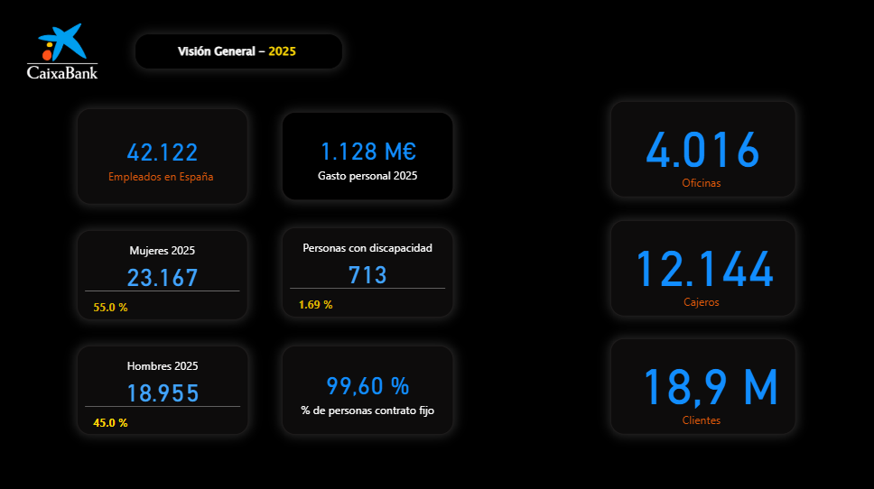
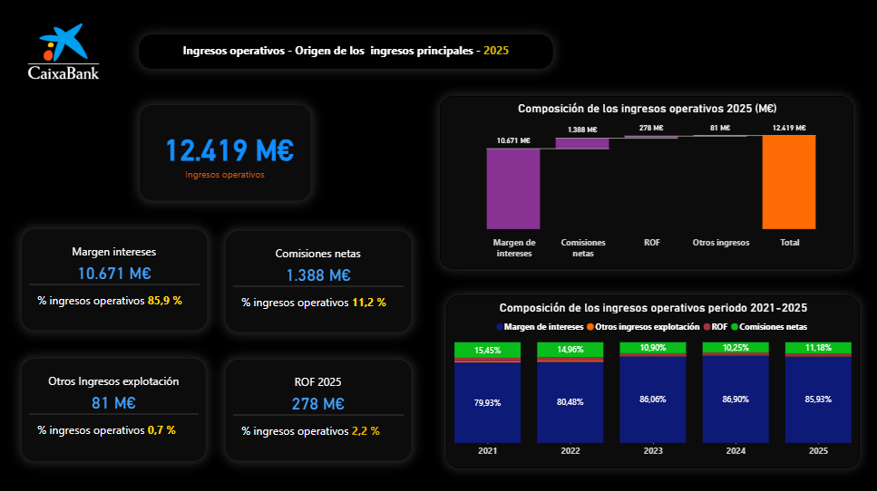
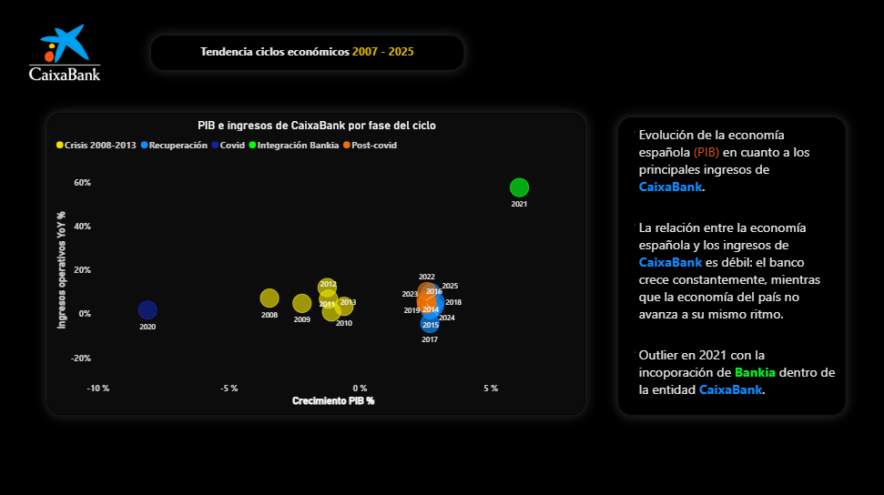
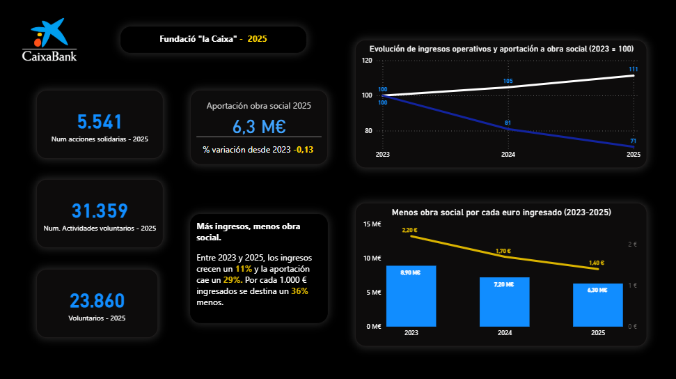
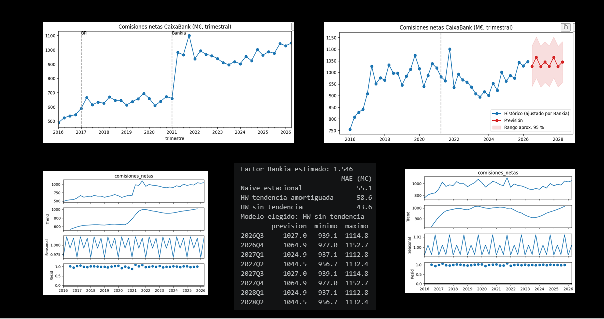
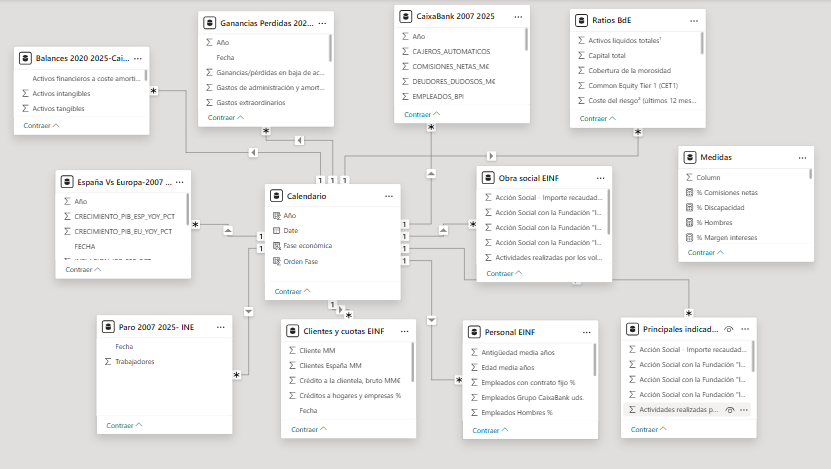

# CaixaBank.-Un mundo detrás de la estrella.-
Análisis de CaixaBank entre 2007 y 2025 con datos del banco, INE, Banco de España y BCE y propias fuentes de CaixaBank


# CaixaBank en Power BI: estructura, ingresos y ciclo económico

> **Estado del proyecto: en desarrollo.** Esta es una primera versión. Quedan por explorar muchas más líneas de análisis (ver [Próximos pasos](#próximos-pasos)).

## Objetivo

Analizar la evolución y la estructura de **CaixaBank** entre 2007 y 2025, combinando datos propios del banco con indicadores económicos de España y Europa. El proyecto busca responder a tres preguntas:

1. ¿Cómo es el banco hoy (plantilla, red, clientes, costes)?
2. ¿De dónde vienen sus ingresos y cómo ha cambiado su reparto?
3. ¿Hasta qué punto depende su negocio del ciclo económico?

## Contenido del informe

### 1. Contexto 2025
Radiografía del banco: plantilla total y reparto entre hombres y mujeres, oficinas, cajeros, número de clientes y coste de personal anual. Todo en tarjetas, con las cifras monetarias en millones de euros (M€).



### 2. Ingresos operativos
Los **12.419 M€** ingresados en 2025 se descomponen en:

- Margen de intereses
- Comisiones netas
- Resultado de operaciones financieras (ROF)
- Otros ingresos de explotación

Incluye un **gráfico de cascada** con la composición del total en 2025 y un **gráfico de columnas apiladas al 100 %** que compara el peso de cada fuente entre 2021 y 2025.



### 3. Tendencia en ciclos económicos

**Gráfico de dispersión** que relaciona el crecimiento del PIB de España con el crecimiento interanual de los ingresos del banco. Cada punto es un año; el color indica la fase del ciclo (crisis 2008-2013, recuperación, Covid y post-covid) y el tamaño refleja el volumen de ingresos. El año 2021 se anota aparte porque su salto responde a la integración de Bankia.

### 4. Obra social de "la Caixa"



**Más ingresos, menos obra social.** Tomando 2023 como base 100, los ingresos operativos de CaixaBank crecen un **11%** hasta 2025, impulsados por la subida de tipos de interés, mientras que la aportación a la obra social cae un **29%** (de 8,9 a 6,3 M€). Como resultado, el esfuerzo social relativo (aportación por cada 1.000 € ingresados) se reduce un **36%** en solo dos años.

### 5. Predicción modelo Holt-Winters


## Resumen

- **Datos:** 42 trimestres (2016T1 a 2026T2) extraídos de los Excel de resultados trimestrales de CaixaBank.
- **Problema:** en 2021 las comisiones saltan de 659 a 981 M€ (+49 %). No es crecimiento real, sino un cambio de perímetro por la integración de Bankia, y un modelo lo confundiría con tendencia.
- **Solución:** se calcula un factor de ajuste (K = 1,546) y se multiplica el histórico anterior a 2021T2, de modo que la serie queda en la escala real y actual.
- **Modelo elegido:** Holt-Winters **sin tendencia**, con estacionalidad de 4 trimestres. Mejora un 21 % el error de la referencia simple.
- **Resultado:** nivel estable de unos 1.040 M€ por trimestre, con un patrón estacional que se repite cada año.

## Metodología

1. **Extracción y limpieza.** Un script lee la fila "Comisiones netas" de cada Excel (cada archivo trae solo 5 trimestres), los junta y, si un trimestre aparece en varios archivos, conserva la cifra del más reciente, porque el banco reexpresa datos históricos. El script descarta lecturas absurdas y avisa de saltos o discrepancias entre archivos.
2. **Exploración.** Gráfico de la serie y descomposición en tendencia, estacionalidad y residuo. Se detecta el salto de Bankia (y uno menor por BPI en 2017).
3. **Ajuste por Bankia.** El factor es la media de los 4 trimestres posteriores a la fusión entre la de los 4 anteriores:

   ```
   K = media(2T21 … 1T22) / media(2T20 … 1T21) = 1,546
   ```

   Se sube el histórico anterior en lugar de bajar los datos posteriores, para que la previsión salga directamente en la escala real.
4. **Evaluación.** Se apartan los últimos 4 trimestres como prueba y se comparan tres modelos con MAE y MAPE.
5. **Previsión.** Se reentrena el mejor modelo con todos los datos y se predicen 8 trimestres con un rango aproximado del 95 %.

## Resultados

Error en los 4 trimestres de prueba:

| Modelo | MAE (M€) | MAPE (%) |
|---|---|---|
| Naive estacional (referencia) | 55,1 | 5,39 |
| Holt-Winters con tendencia amortiguada | 58,6 | 5,68 |
| **Holt-Winters sin tendencia** | **43,6** | **4,21** |

Previsión por trimestre del año (se repite de 2026T3 a 2028T2):

| Trimestre | Previsión (M€) | Mínimo | Máximo |
|---|---|---|---|
| 3.er trimestre | 1.027,0 | 939,1 | 1.114,8 |
| 4.º trimestre | 1.064,9 | 977,0 | 1.152,7 |
| 1.er trimestre | 1.024,9 | 937,1 | 1.112,8 |
| 2.º trimestre | 1.044,5 | 956,7 | 1.132,4 |




El histórico anterior a 2021T2 que aparece en los gráficos está **ajustado por Bankia** (multiplicado por K), por lo que no coincide con las cifras publicadas por el banco.
## Conclusiones preliminares

- El margen de intereses aporta cerca del **86 %** de los ingresos y ha ganado peso desde 2021, por lo que el banco es más sensible a la evolución de los tipos de interés.
- Las comisiones son la segunda fuente (**11,2 %**); el ROF y otros ingresos tienen un peso marginal.
- La relación entre PIB e ingresos del banco parece **débil**: los ingresos crecen incluso en años de PIB negativo (crisis y Covid).
- El salto de **2021 (+58 %)** se debe a la integración de Bankia, no al ciclo económico.

> Son correlaciones observadas con pocos datos anuales; no demuestran causalidad.

## Datos y modelo

**Fuentes** (según las tablas del modelo):

- Informes y datos de resultados de CaixaBank (ingresos, gastos, provisiones, balances).
- Información no financiera del banco (EINF): clientes, cuotas de mercado, personal y obra social.
- INE: paro.
- Banco de España: ratios del sector.
- BCE / Eurostat: comparativa España frente a la eurozona (PIB, inflación, paro, prima de riesgo).

**Modelo:** esquema en estrella con una tabla `Calendario` como eje común. Las tablas de hechos se relacionan con ella en sentido uno a varios, lo que permite filtrar todo con un único año y cruzar datos del banco con datos macroeconómicos.



## Técnicas utilizadas

- Limpieza y transformación de datos con Power Query.
- Medidas DAX: variación interanual, composición porcentual, saldos con `LASTDATE`, `REMOVEFILTERS` y formato dinámico.
- Columnas calculadas (por ejemplo, la fase del ciclo económico).
- Visualizaciones: tarjetas, cascada, columnas apiladas, dispersión con leyenda y tamaño.
- Diseño: fondo oscuro, paleta azul y amarillo y unidades siempre en M€.

## Próximos pasos

- Conseguir el desglose del crédito por tipo y construir la página de crédito con su evolución temporal.
- Analizar la relación entre **paro, provisiones y morosidad** (coste del riesgo).
- Comparar a CaixaBank con el **sector** usando los ratios del Banco de España.
- Estudiar el efecto de los **tipos de interés** sobre el margen de intereses.
- Añadir KPIs de eficiencia (ratio de eficiencia, ingresos por empleado, coste de personal sobre ingresos).
- Incorporar selector de año y variación interanual en las tarjetas.
- Analizar el efecto de la integración de Bankia con más detalle.


